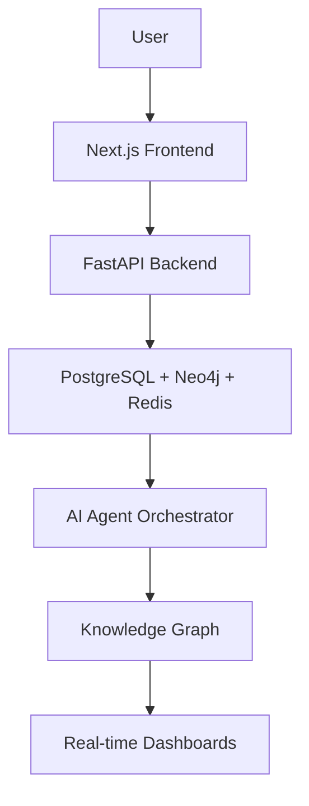

# Tessera

## Project Vision

Tessera is an enterprise AI-native cyber-financial fusion intelligence platform that unifies
cybersecurity, fraud detection, financial intelligence, AI agents, and knowledge graphs into a
single investigation platform.

The long-term goal is to help analysts, investigators, and engineering teams connect signals across
security events, suspicious transactions, identity activity, infrastructure telemetry, and entity
relationships. Tessera is designed to become a production-grade platform where AI agents assist
investigations, knowledge graphs preserve context, and real-time dashboards surface risk as it
emerges.

## Problem Statement

Modern enterprises face cybercrime, payment fraud, insider threats, account takeover, sanctions
exposure, mule networks, and financial crime as overlapping problems. In practice, the tools used to
investigate these risks are often separated by department and data model.

Traditional SIEM platforms focus on security telemetry. Fraud systems focus on transaction rules and
behavioral anomalies. AML platforms focus on customer due diligence, watchlists, and regulatory
reporting. Each system may be valuable on its own, but the separation creates blind spots:

- Cyber indicators are not always connected to financial behavior.
- Fraud patterns are not always linked to infrastructure, devices, or identities.
- AML investigations often lack real-time security and behavioral context.
- Analysts must manually correlate evidence across disconnected tools.
- Case knowledge is lost when relationships are stored only in tickets, spreadsheets, or logs.

Tessera addresses this by treating cyber, fraud, and financial intelligence as one connected
investigation graph, enriched by AI-assisted workflows and real-time risk scoring.

## High-Level Architecture



## Repository Structure

```text
tessera/
  frontend/          Next.js web application and user experience layer.
  backend/           FastAPI services, APIs, domain logic, and agent orchestration.
  infrastructure/    Docker, Kubernetes, Terraform, and deployment configuration.
  synthetic-data/    Synthetic cyber, fraud, transaction, and graph datasets.
  docs/              Architecture, design decisions, project notes, and reports.
  .github/           GitHub issue templates, pull request template, Dependabot, and CI.
```

## Technology Stack

### Frontend

- Next.js
- TypeScript
- Tailwind CSS
- shadcn/ui
- Framer Motion
- Three.js

### Backend

- FastAPI
- Python

### Databases

- PostgreSQL
- Neo4j
- Redis

### Streaming

- Kafka / Redpanda

### AI

- OpenAI
- LangGraph
- GraphRAG

### Infrastructure

- Docker
- Kubernetes
- Terraform
- GitHub Actions

### Deployment

- Vercel
- Railway
- Neo4j Aura

## Development Roadmap

- [x] Repository Foundation
- [ ] Frontend
- [ ] Backend
- [ ] Authentication
- [ ] Database
- [ ] Live Streaming
- [ ] AI Agents
- [ ] GraphRAG
- [ ] Risk Scoring
- [ ] 3D Graph Explorer
- [ ] Reporting
- [ ] Security
- [ ] Deployment
- [ ] Testing
- [ ] Final Release

## Local Development Setup

### Required Tools

- Git
- Node.js
- pnpm
- Python
- Docker

### Installation

Install Git from the official Git distribution for your operating system.

Install Node.js using a version manager such as `nvm`, `fnm`, or Volta. This repository is
configured as a pnpm monorepo.

Enable pnpm through Corepack:

```bash
corepack enable
corepack prepare pnpm@latest --activate
```

Install Python using the official Python distribution or a version manager such as `pyenv`.

Install Docker Desktop or a compatible Docker Engine distribution for local services.

### Future Setup Commands

The following commands will be expanded as the frontend, backend, database, and infrastructure
layers are implemented.

```bash
pnpm install
pnpm lint
pnpm format:check
pnpm test
```

Backend, database, streaming, and container setup commands will be added when those systems are
introduced.

## Folder Responsibilities

### `frontend`

Contains the planned Next.js application, TypeScript UI code, design system integration, dashboard
experiences, graph visualization, authentication screens, and investigator workflows.

### `backend`

Contains the planned FastAPI application, service boundaries, API routes, domain models, agent
orchestration, risk scoring logic, data access, and integrations with databases, streaming, and AI
providers.

### `infrastructure`

Contains deployment and operations configuration such as Docker, Kubernetes, Terraform, environment
templates, observability configuration, and future cloud deployment assets.

### `synthetic-data`

Contains generated or curated synthetic datasets for cybersecurity telemetry, fraud scenarios,
transaction graphs, identity relationships, and testing fixtures. No real customer or sensitive
production data should be committed here.

### `docs`

Contains architecture notes, design decisions, diagrams, project reports, threat models, research
summaries, and final-year engineering project documentation.

### `.github`

Contains GitHub repository automation including issue templates, pull request templates, Dependabot
configuration, and CI workflows.

## Coding Standards

### Formatting

Prettier is the default formatter for Markdown, JSON, YAML, JavaScript, TypeScript, and related
frontend configuration files.

```bash
pnpm format
pnpm format:check
```

### Linting

ESLint is configured at the repository root for JavaScript and TypeScript files. Ruff is configured
for future Python code.

```bash
pnpm lint
pnpm lint:js
pnpm lint:python
```

### Git Workflow

- Default branch: `main`
- Feature branches: `feature/<short-description>`
- Bug fix branches: `fix/<short-description>`
- Documentation branches: `docs/<short-description>`
- Chore branches: `chore/<short-description>`
- Experimental branches: `experiment/<short-description>`

Keep pull requests focused, reviewable, and tied to a clear issue or milestone when possible.

### Commit Conventions

Use concise, conventional commit-style messages:

- `feat: add graph risk scoring prototype`
- `fix: correct transaction normalization logic`
- `docs: update architecture overview`
- `test: add backend service tests`
- `chore: update dependency configuration`

### Pull Request Expectations

Pull requests should include:

- A clear summary of the change.
- The reason the change is needed.
- Any relevant screenshots or diagrams for UI or architecture changes.
- Local checks that were run.
- Notes about security, privacy, data handling, or migration impact.

## Future Milestones

This section will be updated as development progresses.

- Define MVP user journeys and investigation workflows.
- Establish frontend application shell and design system.
- Implement backend service skeleton and API contracts.
- Add authentication and authorization.
- Add PostgreSQL, Neo4j, and Redis integration.
- Add synthetic cyber-financial event generation.
- Add streaming ingestion with Kafka or Redpanda.
- Add AI agent orchestration with LangGraph.
- Add GraphRAG over the investigation knowledge graph.
- Add risk scoring and alert prioritization.
- Add 3D graph explorer and real-time dashboards.
- Add report generation and case export workflows.
- Add security hardening, audit logging, and threat modeling.
- Add deployment pipelines and production environment documentation.
- Add complete automated testing and final release validation.

## License

Tessera is licensed under the MIT License. See [LICENSE](LICENSE) for details.
